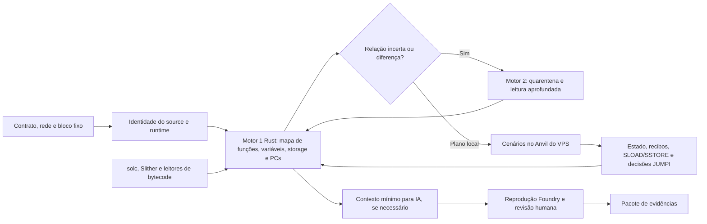

# Caminho da leitura automática

O primeiro motor organiza fatos do source, bytecode e histórico. O segundo reexamina apenas uma relação marcada com incerteza ou diferença concreta e devolve o resultado ao mapa. Os cenários usam fork local com bloco e runtime fixos; nenhum envio de transação à rede faz parte desse caminho. A IA recebe contexto limitado depois dos filtros determinísticos. Uma hipótese só avança com reprodução e revisão.

Na medição privada do YieldVault, 41 dos 110 PCs `JUMPI` estáticos têm origem única em uma função/modifier do source verificado; 69 permanecem sem atribuição. A rodada local teve 36 casos e nenhum resultado novo frente à anterior. Esses números medem observações e limites do mapa, não certificam ausência de problemas nem cobertura de todos os caminhos alcançáveis. Consulte [cadeia de variáveis](VARIABLE-LENS.md) e [checklist](ROADMAP-CHECKLIST.md).
